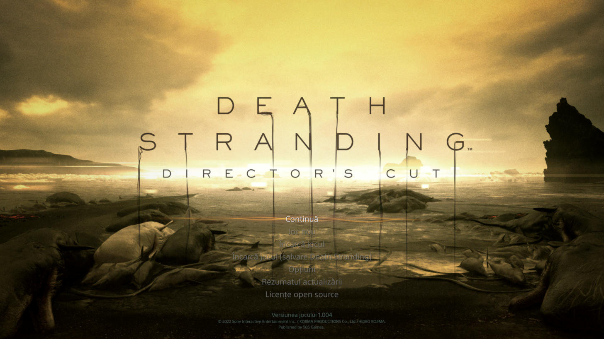
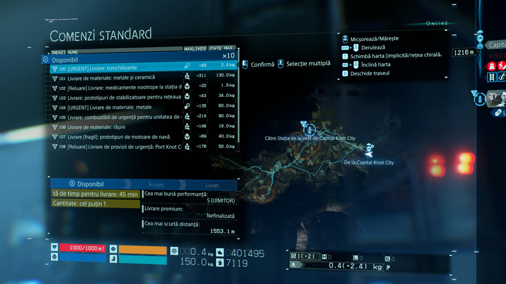
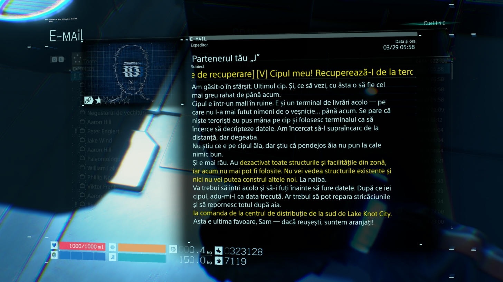

# Death Stranding Director's Cut în limba română

Traducere neoficială și gratuită pentru **Death Stranding Director's Cut** (Steam, versiunea 1.004), cu diacritice corecte și limbaj modern. Limbajul vulgar e păstrat ca în original.

Autor: **VonMitza**

## Descărcare

Ia arhiva `DS_Romana.zip` de la [ultima versiune](https://github.com/VonMitza/death-stranding-romana/releases/latest).

## Instalare

1. Dezarhivează toată arhiva într-un folder oarecare.
2. Închide jocul și pornește `Instaleaza.bat`. Îți trebuie aproximativ 13 GB liberi pe discul jocului. Durează câteva minute.
3. În joc, la **Opțiuni → Setări de limbă**, lasă limba textului pe **English**. Româna înlocuiește textul englezesc, de aceea în meniu scrie tot „English”. Vocile pot rămâne pe limba preferată.

## Dezinstalare

Pornește `Dezinstaleaza.bat`. Jocul revine la original din backup-ul făcut la instalare. Dacă ai șters backup-ul, folosește **Verify integrity of game files** din Steam.

## Ce e tradus

- Dialogurile, subtitrările, mailurile, interviurile, meniurile, comenzile și sfaturile (peste 21.000 de texte).
- Titlurile de episod, citatul de la început și panourile holografice principale din joc.
- Genericul: funcțiile din credite și cartonașele de la început.

## Ce rămâne în engleză

- Numele din generic, titlurile și versurile melodiilor.
- Textul integrat în filmele jocului (de exemplu „Developed by”).
- Logourile (UCA, Bridges), semnele orașelor Knot și inscripțiile mici de pe obiecte.
- Câteva texte din HUD, inclusiv busola.
- Vocile: traducerea e doar pentru text.

## După o actualizare a jocului

Steam poate înlocui fișierul modificat. Dacă textul revine la engleză, șterge `data\59b95a781c9170b0d13773766e27ad90.bin.bak` din folderul jocului și pornește din nou `Instaleaza.bat`.

## Note

Pachetul nu conține fișiere ale jocului. Instalatorul modifică doar copia ta, iar salvările nu sunt afectate.

Proiectul nu are legătură cu Kojima Productions, Sony sau 505 Games. Death Stranding este marcă a deținătorilor săi.

Instalatorul folosește [Decima Workshop](https://github.com/ShadelessFox/decima-workshop), licență GPLv3, inclus în arhivă împreună cu licența sa.

